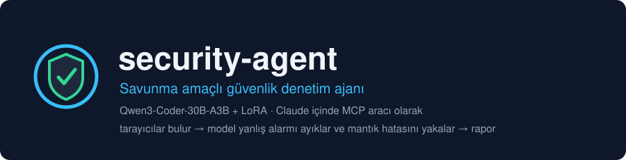
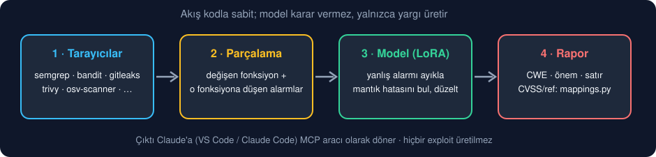
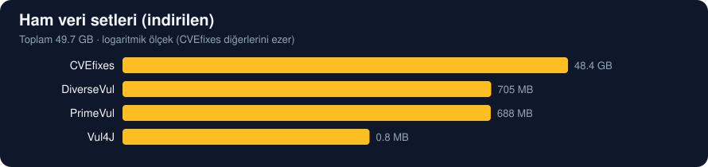
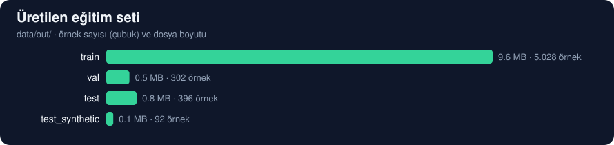
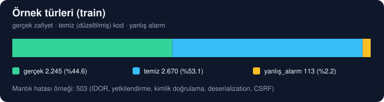
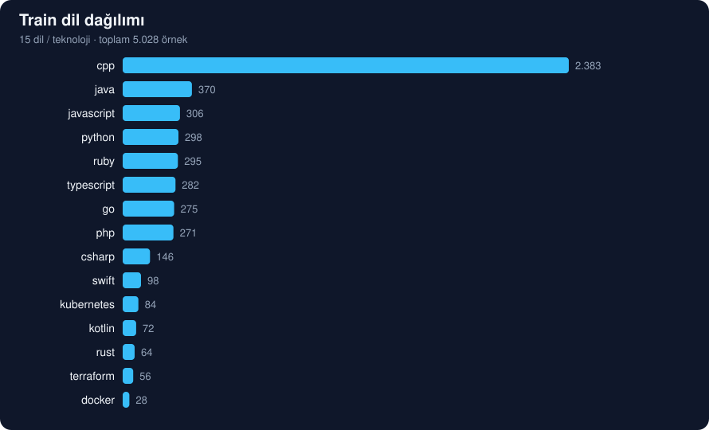

<p align="center">
  
</p>

<p align="center">
  
  
  
  
  
</p>

<p align="center">
  <a href="#durum">Durum</a> ·
  <a href="#nasıl-çalışır">Nasıl çalışır</a> ·
  <a href="#veri-setleri">Veri setleri</a> ·
  <a href="#kurulum">Kurulum</a> ·
  <a href="#çalışma-sırası">Çalışma sırası</a> ·
  <a href="#lisans-notu">Lisans</a>
</p>

# security-agent

Qwen3-Coder-30B-A3B'yi LoRA ile ince ayarlayıp Claude içinde (VS Code ve Claude Code, MCP aracı
olarak) çalışan, **savunma amaçlı** bir güvenlik denetim ajanı.

```text
tara -> parçala -> yargıla -> raporla
```

> Tarayıcıların yanlış alarmlarını ayıkla, araçların kaçırdığı mantık hatalarını yakala.

**Kapsam yalnızca savunma:** zafiyet tespiti (SAST), bağımlılık/sır/yapılandırma denetimi ve
düzeltme önerisi. Hiçbir exploit veya saldırı yükü üretilmez/çalıştırılmaz.

## Nasıl çalışır

<p align="center">
  
</p>

Akış kodla sabit, model karar vermez: (1) tarayıcılar deterministik çalışır, (2) model çıktıları
ayıklar + kodu inceler + rapor yazar, (3) rapor Claude'a döner. Modelin asıl becerisi
tarayıcıların **yanlış alarmlarını** ayıklamak ve araçların kaçırdığı mantık hatalarını bulmaktır.

## Hızlı başlangıç

```bash
pip install -e ".[dev,scanners]"
secagent-fetch                                  # ham veri durumu
secagent-build --cvefixes --per-language 40 --synthetic 8 --enrich --out-dir
secagent-train --config train/config.yaml --dry-run
```

Ayrıntılar aşağıda: [Kurulum](#kurulum) ve [Çalışma sırası](#çalışma-sırası).

## Durum

| Faz | Kapsam | Durum |
|---|---|---|
| Veri hazırlama | `dataprep/`, tarayıcılar, şema, eşlemeler | Tamam, yerelde çalışıyor |
| İstem / biçim | `prompt.py`, `train/format.py` (eğitim = değerlendirme = MCP aynı biçim) | Tamam |
| Değerlendirme | `eval/` (metrikler, `oracle`/`null`/MLX arka uçları) | Tamam |
| Eğitim altyapısı | `train/` (LoRA, Spot, S3, devam) | CPU duman testiyle doğrulandı; **GPU/AWS'de denenmedi** |
| Dışa aktarım | `export/` (LoRA birleştirme, GGUF/MLX) | Henüz yok |
| MCP sunucusu | `mcp_server/` (Claude içinde araç) | Henüz yok |

## Yapı

```
security-agent/
├── pyproject.toml            paket + bağımlılıklar + CLI giriş noktaları
├── src/secagent/             ortak kod (train/, export/, mcp_server/ bunu içe aktarır)
│   ├── schema.py             eğitim örneği şeması + doğrulayıcı (15 dilin tek kaynağı)
│   ├── mappings.py           CWE → referans/CVSS/ad/aile eşlemeleri (deterministik)
│   ├── paths.py              depo içi yollar
│   ├── scanners/
│   │   ├── runners.py        15 dil → dile göre tarayıcılar → ortak JSON
│   │   └── rules.py          CWE bildirmeyen kurallar için CWE + gürültü filtresi
│   └── dataprep/             eğitim verisi hazırlama (GPU gerektirmez)
│       ├── build.py          kayıtları şema-doğrulamalı train/val/test JSONL'e çevirir
│       ├── enrich.py         gerçek tarayıcı çıktısı + yanlış-alarm etiketleme
│       ├── splits.py         repo bazında sızıntısız bölme, kod hash'iyle tekilleştirme
│       ├── stats.py          dil / CWE / tür dağılımı
│       ├── fetch.py          ham veri durumu + edinme talimatları
│       └── sources/          veri kaynağı okuyucuları (cvefixes, primevul, sentetik şablonlar)
│   ├── prompt.py             model istemi, hedef JSON biçimi, çıktı ayrıştırıcı (eğitim=eval=MCP)
│   ├── eval/                 metrikler, tahmin arka uçları, secagent-eval
│   └── train/                SFT biçimi, veri seti, LoRA, Spot/S3 dayanıklılığı, secagent-train
├── train/                    eğitim yapılandırması ve AWS başlatıcı (config.yaml, launch.sh,
│                             constraints.txt: GPU makinesi için sabitlenmiş sürümler)
├── data/
│   ├── samples/              elle hazırlanmış örnekler (depoda)
│   ├── raw/                  indirilen ham veri, ≈ 50 GB (git dışı; CVEfixes.db burada)
│   └── out/                  üretilen train/val/test.jsonl + data_card.json, ≈ 11 MB (git dışı)
├── assets/                   README görselleri (SVG; scripts/make_assets.py üretir)
├── scripts/                  yardımcı betikler (make_assets.py)
├── tests/
├── export/   mcp_server/                 (sıradaki fazlar; henüz yok)
```

## Veri setleri

### Ham veri (`data/raw/`, indirilen, git dışı, toplam ≈ 50 GB)

<p align="center">
  
</p>

| Kaynak | Boyut | Ana dosyalar | Kullanım |
|---|---|---|---|
| **CVEfixes** | ≈ 48 GB | `CVEfixes.db` 48,3 GB; `cwec_v4.15.xml` 14 MB; `extras/` (NVD arşivi 68 MB, günlük 27 MB, makale, ER şeması) | Birincil kaynak: 11 dil, gerçek CVE düzeltmeleri |
| **PrimeVul** | 688 MB | `primevul_train.jsonl` 449 MB; `test` 63 MB; `valid` 61 MB; `file_info.json` 54 MB; eşli (`*_paired`) 50 / 5,8 / 5,4 MB | C/C++ eşli fonksiyonlar |
| **DiverseVul** | 705 MB | `diversevul_20230702.json` 703 MB; `diversevul_metadata.json` 2,1 MB | İndirildi, **kullanılmıyor** (etiket gürültüsü) |
| **Vul4J** | < 1 MB | `vul4j_dataset.csv` 0,1 MB; `patches/` 128 yama (≈ 0,7 MB) | Okuyucu yok (tam kaynak yok, yalnızca yama parçaları) |

Kaynakların repo adresi ve lisans notu `data/raw/manifest.json` içindedir.

### Model önbelleği (proje dışı)

`~/.cache/huggingface/hub/`: `mlx-community/Qwen3-Coder-30B-A3B-Instruct-4bit` 8,4 GB
(yerel değerlendirme için MLX arka ucu). Eğitim tabanı `Qwen/Qwen3-Coder-30B-A3B-Instruct`
GPU makinesinde indirilir.

### Üretilen eğitim seti (`data/out/`, ≈ 11 MB)

<p align="center">
  
</p>

| Bölme | Dosya | Boyut | Örnek | Gerçek | Temiz | Yanlış alarm | Mantık hatası |
|---|---|---|---|---|---|---|---|
| train | `train.jsonl` | 9,6 MB | 5.028 | 2.245 | 2.670 | 113 | 503 |
| val | `val.jsonl` | 0,55 MB | 302 | 129 | 165 | 8 | 30 |
| test | `test.jsonl` | 0,81 MB | 396 | 170 | 211 | 15 | 39 |
| test (sentetik) | `test_synthetic.jsonl` | 0,11 MB | 92 | – | – | – | – |

Toplam 5.818 örnek. Train içinde dil dağılımı: cpp 2.383, java 370, javascript 306, python 298,
ruby 295, typescript 282, go 275, php 271, csharp 146, swift 98, kubernetes 84, kotlin 72,
rust 64, terraform 56, docker 28. En sık CWE'ler: CWE-119, 79, 20, 120, 502, 287, 863, 89.
<p align="center">
  
</p>

<p align="center">
  
</p>

Güncel dağılım için `secagent-stats data/out/train.jsonl`; ayrıntı `data/out/data_card.json`.
Bu sayılar son üretimin anlık görüntüsüdür; `secagent-build` yeniden çalışınca değişir.

## Kurulum

```bash
pip install -e ".[dev,scanners]"
brew install semgrep osv-scanner gitleaks trivy cppcheck flawfinder hadolint \
             gosec govulncheck ruby
# brakeman Homebrew'da yok; Ruby >= 3.2 gerekir (macOS sistem Ruby'si 2.6 yetmez)
export PATH="/opt/homebrew/opt/ruby/bin:/opt/homebrew/lib/ruby/gems/4.0.0/bin:$PATH"
gem install brakeman
```

Araçların hepsi olmasa da boru hattı çalışır; eksik araç atlanır. Semgrep ilk çalışmada
kural indirir (ağ gerekir).

## Çalışma sırası

```bash
secagent-fetch                    # ham veri durumu; eksikse CVEfixes talimatını yazar
secagent-scan /yol/proje --lang python

# Eğitim verisi: gerçek (CVEfixes) + sentetik, gerçek tarayıcı çıktısıyla
secagent-build --cvefixes --per-language 40 --synthetic 8 --enrich --out-dir
secagent-validate data/out/train.jsonl
secagent-stats data/out/train.jsonl

pytest --cov=secagent
```

`--cvefixes` ve `--out-dir` değer verilmezse `data/raw/CVEfixes/CVEfixes.db` ve `data/out/`
kullanılır.

### Eğitim (hazırlık; GPU'ya geçmeden önce)

```bash
conda create -n secagent-train python=3.12 && conda activate secagent-train
pip install -e ".[train,dev]"                 # GPU makinesinde: ".[train,train-gpu]"

secagent-train --config train/config.yaml --dry-run   # token/adım/maliyet raporu, GPU yok
pytest                                                # CPU duman testi: eğitim, devam, Spot, S3
secagent-eval predict --gold data/out/test.jsonl --backend null --out /tmp/p.jsonl
secagent-eval score   --gold data/out/test.jsonl --pred /tmp/p.jsonl   # metrikler
```

- **Biçim:** model YALNIZCA yargıyı üretir (`cwe, severity, function, line, title, evidence,
  fix, false_positive, summary`); `references`/`cvss` çıkarım sonrası `mappings.py`'den eklenir.
  İstem numaralı satırlar içerir; kayıp yalnızca asistan JSON'una hesaplanır.
- **Değerlendirme:** ayrıştırma oranı, precision/recall, **yanlış alarm ayıklama oranı**, temiz
  koda yanlış alarm oranı, halüsinasyon (kod dışı satır, kodda olmayan kanıt), mantık hatası
  recall'u, dil başına döküm. `oracle` (üst sınır) ve `null` (alt sınır) arka uçları sağlık kontrolüdür.
- **Spot:** her kayıtta S3'e itilir (önce veri, sonra `COMPLETE` işareti), açılışta en son TAM
  checkpoint'ten devam edilir, kesinti bildirimi gelince kaydedip durur (çıkış kodu 75).
- **AWS:** `train/launch.sh` (EC2'de çıkışta makineyi kapatır, yerelde asla). AWS üzerinde henüz
  denenmedi; ilk GPU oturumu bir keşif oturumudur (bellek/hız ölçümü, QLoRA mı bf16 LoRA mı).

### Eğitim verisi nasıl üretiliyor

- **Düzey:** `--granularity function` (varsayılan): değişen **fonksiyon** örnek olur. Tarayıcı
  DOSYA üzerinde çalışır, modele yalnızca fonksiyon ve o fonksiyona düşen alarmlar verilir
  (satırlar fonksiyona göre yeniden numaralı). Çıkarımda aynı parçalama kullanılmalıdır.
  `file` ve `both` de var.
- **Çiftler:** her (CVE, dosya/fonksiyon) için bir zafiyetli + bir temiz (düzeltilmiş) örnek.
- **`--enrich`:** düzeltilmiş kodda yamanın CWE'siyle (veya ailesiyle) eşleşen kalıntı alarm
  `false_positive=true` örneği olur. Başka CWE'li/CWE'siz alarmlı kayıtlar belirsiz sayılıp
  atlanır (`--ambiguous drop`: alarmı silip kaydı tutar). `samples/` örneklerine dokunulmaz.
- **`--per-language N`:** her dilden en çok N çift (dengeli örnekleme).
- **`--logic N` (+ `--logic-only`):** her dilden N **mantık hatası** çifti (IDOR, yetkilendirme,
  kimlik doğrulama, deserialization, CSRF; `mappings.LOGIC_CWES`): tarayıcıların çoğunlukla
  kaçırdığı sınıf, projenin başlık becerisi. Gerçek CVEfixes verisinden gelir.
- **`--primevul` (`--primevul-pairs N`, `--primevul-clean N`):** PrimeVul eşli C/C++ fonksiyonları
  (+ alarmsız temiz fonksiyonlar). DiverseVul bilinçli olarak KULLANILMAZ (etiket gürültüsü;
  PrimeVul zaten temizlenmiş üst kümesi; ham veride duruyor). Vul4J: tam kaynak yok (yalnızca
  yama parçaları), okuyucu yazılmadı.
- **Sızıntı:** tüm kaynaklarda bölme anahtarı depo ADI (`group_key`); aynı depo hep aynı bölmede.
  Gerçek veri dil katmanlıdır (`plan_real_splits`).
- **`--synthetic N`:** CVEfixes'ta olmayan teknolojiler (kotlin, swift, docker, terraform,
  kubernetes) için şablon başına N varyant. Yanlış-alarm şablonları yalnızca **gerçek bir
  tarayıcı** o CWE için alarm verirse tutulur (`--enrich` gerekir). Bunlar "gerekçeli istisna"dır
  (ör. CSI eklentisi için privileged). Bir şablonun tüm varyantları aynı bölmeye düşer.
- `cvss`/`references` hedefte kalır ve koddan değil `mappings.py`'den deterministik gelir
  (model URL/CVE uydurmasın diye). `--strip` ile hedeften çıkarılabilir. CVSS, kaynak veride
  (CVEfixes/NVD) varsa gerçek değerdir; yoksa CWE varsayılanı, o da yoksa boş.
- **Bölme:** repo bazında (aynı repo hep aynı bölmede) ve kod hash'iyle tekilleştirilmiş.

## Görselleri yenileme

`assets/*.svg` dosyaları `data/out/data_card.json` ve `data/raw/` boyutlarından üretilir:

```bash
python scripts/make_assets.py
```

## Lisans notu

Her veri setinin lisansı farklıdır; eğitimde yalnızca izin verenleri kullan. CVEfixes verisi
CC BY 4.0 (atıf gerekir; `data/raw/CVEfixes/LICENSE.txt`), kodun lisansı ayrıca kontrol
edilmelidir. Sentetik şablonlar bu depoya aittir.
